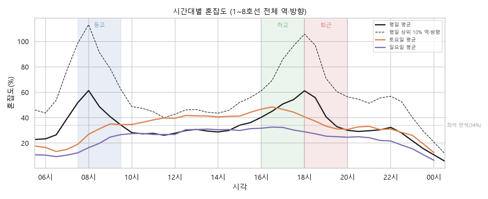
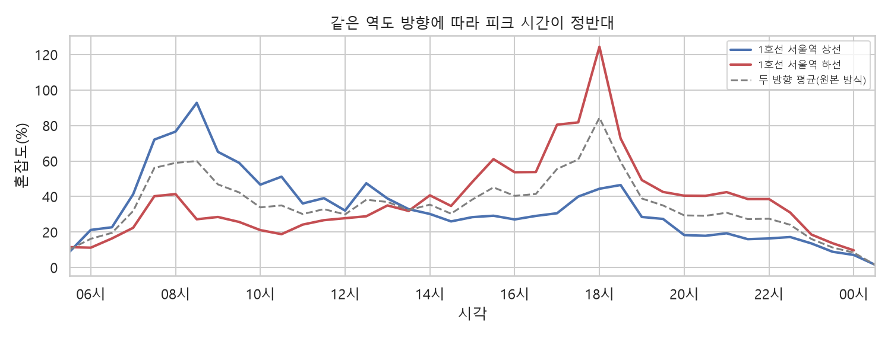

# 대학생 통학 시간대 서울 지하철 혼잡도 분석

> 빅데이터분석개론 팀 프로젝트(4조)를 개인 프로젝트로 처음부터 다시 구현한 저장소입니다.
> 원래 분석의 통계적 한계를 고치고, 결과를 실제로 써볼 수 있는 웹앱으로 확장하는 것이 목표입니다.

## 목표

1. 서울 지하철 1~8호선의 시간대별·역별·방향별 혼잡 패턴을 분석한다.
2. 등교/하교 시간대 혼잡도 차이를 **통계적으로 올바른 방법**으로 검증한다.
3. 출발역·도착역·희망 시간을 넣으면 가장 쾌적한 출발 시각을 추천하는 웹앱을 만든다.

## 원본 프로젝트 대비 개선점

| 원본 | 문제 | 이 저장소 |
|---|---|---|
| 등교 시간 정의가 슬라이드마다 다름 | 비교 기준 불일치 | `src/subway/config.py`에 시간대 정의를 한 곳에서 관리 |
| 독립표본 t-검정 | 같은 역의 관측치라 독립성 위반 | 역·방향 단위 대응표본 검정 + 효과크기 |
| 변수 1개 OLS를 "다중회귀"라 표기, R²=0.01 | 설명력 부족 | 호선·방향·요일·시간대 등을 넣은 다중회귀 |
| 피어슨 상관으로 시간–혼잡도 관계 해석 | 봉우리형 비선형 관계 | 시간대별 프로파일 곡선으로 해석 |
| K-Means 피처에 환승 여부 포함, 스케일링 없음 | 결과가 자명해짐 | 시간대별 혼잡 프로파일로 군집화, 실루엣 점수로 k 선택 |
| 역명 중복으로 환승역 판별 | 1~8호선 밖의 환승 누락 | 공식 환승역 목록과 대조 |
| 상·하행 구분 없이 평균 | 방향별 혼잡 차이 소실 | 방향을 분석 단위에 포함 |
| 구간 이동 시간 일괄 5분 가정 | 역간 소요시간 데이터 미사용 | 실제 표준 운행시간으로 경로 시뮬레이션 |

## 데이터

`data/raw/`에 아래 파일을 직접 내려받아 넣습니다. 원본 데이터는 저장소에 올리지 않습니다.

| 데이터 | 제공 | 출처 |
|---|---|---|
| 서울교통공사_지하철혼잡도정보 (1~8호선, 30분 단위) | 서울교통공사 | [공공데이터포털 15071311](https://www.data.go.kr/data/15071311/fileData.do) |
| 서울교통공사 역간거리 및 소요시간 | 서울교통공사 | [서울 열린데이터광장 OA-12034](https://data.seoul.go.kr/dataList/OA-12034/S/1/datasetView.do) |

혼잡도 = 열차 탑승 인원 ÷ 정원(160명/칸) × 100. 34%는 좌석이 다 찬 정도, 100%는 정원 탑승입니다.

## 구조

```
data/raw/         원본 CSV (git 제외)
data/processed/   정제된 데이터 (git 제외)
src/subway/       load.py(불러오기) · clean.py(정제) · config.py(기준값)
notebooks/        탐색·분석 노트북
reports/figures/  README·발표용 그래프
app/              Streamlit 웹앱
```

## 실행

```bash
python -m venv .venv
.venv\Scripts\activate
pip install -r requirements.txt nbconvert ipykernel
pip install -e .
python -m ipykernel install --sys-prefix --name subway-congestion
```

노트북은 `notebooks/`에서 `subway-congestion` 커널로 엽니다.

## 주요 발견

### 1. EDA ([01_eda.ipynb](notebooks/01_eda.ipynb))



- **0값 5.7%는 '혼잡도 0%'가 아니다.** 42개 역·방향은 종착 방향이라 하루 종일 0이고, 나머지는 첫차 전·막차 후다. 원본처럼 중앙값으로 채우면 열차가 없는 시간에 가짜 혼잡도가 생긴다.
- **평균은 피크를 가린다.** 평일 08시 전체 평균은 61%지만, 상위 10% 역·방향은 113%다. 등교 시간대 최상위(7호선 군자·중곡 하선, 8호선 몽촌토성 하선, 2호선 사당 외선)는 평균 130%를 넘는다.
- **방향을 섞으면 안 된다.** 같은 역 양방향의 혼잡도 차이는 08시 기준 중앙값 41%p다. 1호선 서울역은 아침엔 상선, 저녁엔 하선이 붐빈다.



- **1~8호선만으로는 환승역을 제대로 판별할 수 없다.** 신도림·홍대입구·강남·선릉처럼 다른 노선과 환승하는 큰 역이 '일반역'으로 분류된다.
- **실제 구간 소요시간은 평균 1.56분이다.** 원본 프로그램이 가정한 5분의 3분의 1 수준이다.

## 진행 상황

- [x] 프로젝트 구조, 데이터 불러오기 모듈
- [x] 결측·이상치 점검(EDA), 정제 모듈
- [ ] 전체 수도권 노선 기준 환승역 목록
- [ ] 등교/하교 비교 검정
- [ ] 회귀 분석
- [ ] 시간대 프로파일 군집화
- [ ] 역간 소요시간 기반 경로 그래프
- [ ] Streamlit 앱 + 배포
